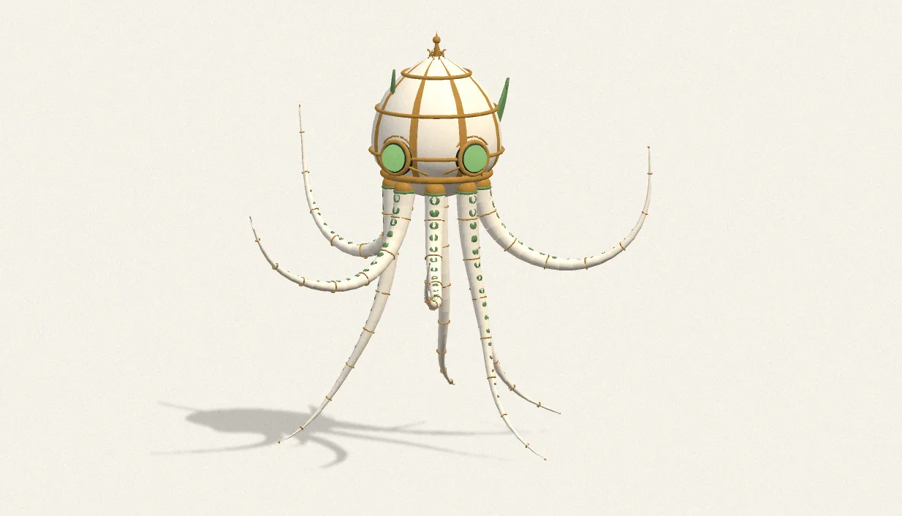
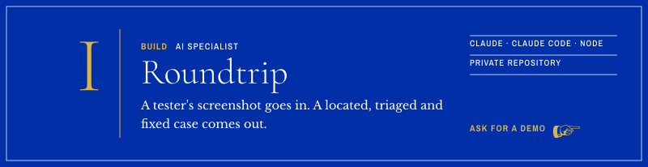
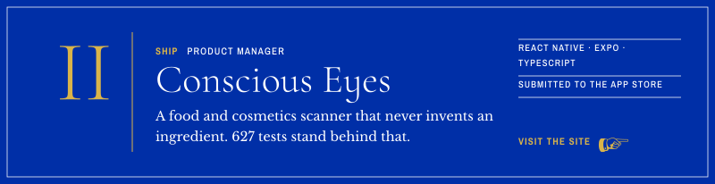
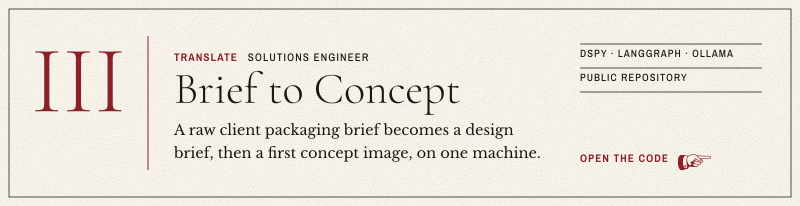

  

  <picture><source media="(max-width: 600px)" srcset="assets/intro-narrow.svg"></picture>

<a href="https://www.linkedin.com/in/nihan-bayrak/">LinkedIn</a> · <a href="https://consciouseyes.app">consciouseyes.app</a>

  <picture><source media="(max-width: 600px)" srcset="assets/commits-narrow.svg"></picture>

## Pick a card

Three jobs, one person. Each card opens its own door, and the case file under it holds the proof.

<a href="https://www.linkedin.com/in/nihan-bayrak/"><picture><source media="(max-width: 600px)" srcset="assets/card-1-narrow.svg"></picture></a>

☞ Case file I · Roundtrip

 

A beta tester sends a screenshot and four words: *"It doesn't work."* Roundtrip reads the
screenshot to work out what they were trying to do, finds that screen in the code, and
decides whether it is a bug to fix or a call for a person to make. Bugs go to a coding
agent, and the next build's release note is drafted to tell the tester theirs was fixed.
Eleven tester reports from Conscious Eyes have gone through it. All eleven are fixed.

`Claude · Claude Code · App Store Connect API · Node` · private repository, demo on request

<a href="https://consciouseyes.app"><picture><source media="(max-width: 600px)" srcset="assets/card-2-narrow.svg"></picture></a>

☞ Case file II · Conscious Eyes

 

When it does not know, it says so: an empty record reads *not found*, and a grade built
from ingredients alone says the nutrition is unknown. I wrote the spec, including what it
refuses to do, ran it through TestFlight with real testers, and submitted it to the App
Store. 627 tests stand behind it.

`React Native · TypeScript · Expo` · [consciouseyes.app](https://consciouseyes.app)

<a href="https://github.com/nihanbayrak/Ollama_pipeline"><picture><source media="(max-width: 600px)" srcset="assets/card-3-narrow.svg"></picture></a>

☞ Case file III · Brief to Concept

 

The agency's problem, solved where the agency can trust it. A raw client packaging brief
becomes a structured design brief, then a first concept image, on one machine. Client
material never touches an outside API.

`DSPy · LangGraph · Ollama · Python` · [the repository](https://github.com/nihanbayrak/Ollama_pipeline)

 

☞ What I hold to

 

- **Untrusted text is data.** A tester's words go into Roundtrip as evidence, never as
  instructions. Text written at an AI is quarantined, not obeyed.
- **No match, no trust.** When a model reads a screenshot, the text it claims to see on
  screen is searched for in the source. If it is not there, the reading does not drive a fix.
- **Measure taste instead of assuming it.** I preregistered a test of LAION's aesthetic
  predictor against my own design references. It scored 39 of 52 below 5 out of 10, and
  had no relation to how I rated them (ρ = −0.02). The full story is coming on Substack.

☞ How this page is made

 

The octopus is a mesh, not a video: 37,327 triangles in 427 parts, rendered frame by frame
in plain numpy with a depth buffer, smooth normals and the PBR materials lifted from the
source model, then a shadow cast onto a floor that is not there. The sheet under it is set like
a 1922 magazine page, and its headline ticks like the automaton above it: every letter steps
up and back through held positions, because a README allows no script and no hover. Drawn by
[`tools/render.py`](tools/render.py) and [`tools/dance.py`](tools/dance.py).

The dots under the sheet are the last year of contributions, redrawn every night from GitHub's own calendar by
[`tools/commits.py`](tools/commits.py). The octopus walks it one week at a time and eats what it finds.

