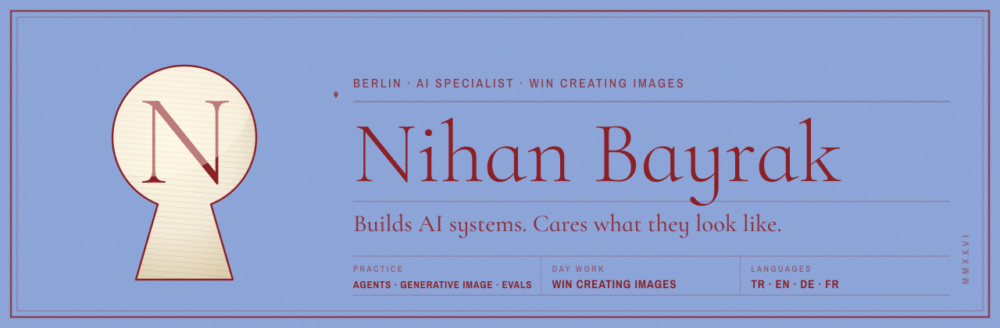
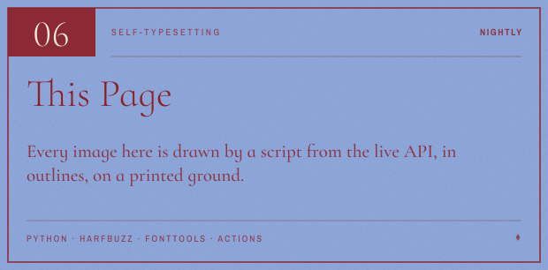

I build AI systems at a creative packaging agency in Berlin, and I care what they
look like when they are finished. Most people in this field have no visual
vocabulary. Most people with a visual vocabulary cannot ship. The interesting
work is in between.

Turkish, English, German, and enough French to be dangerous.

## Selected work

<table>
<tr>
<td width="50%"></td>
<td width="50%"></td>
</tr>
<tr>
<td width="50%"></td>
<td width="50%"></td>
</tr>
<tr>
<td width="50%"></td>
<td width="50%"></td>
</tr>
</table>

## About this page

Nothing here is a badge service. Every image is drawn by
[`tools/render.py`](tools/render.py) from the live GitHub API and redrawn nightly
by [a workflow](.github/workflows/refresh.yml).

GitHub renders README images inside ``, which blocks webfont loading — so the
type is not type. HarfBuzz shapes each line and fontTools converts the glyphs to
outlines, which is why Cormorant Infant and Archivo Narrow survive the trip
intact. The copy and the project list live in
[`data/profile.toml`](data/profile.toml); the layout measures itself against real
glyph widths rather than guessing.

Cornflower ground, oxblood ink, cream structure, after a 19th-century engraved
broadside. Paper grain and a halftone screen on every surface. Nothing ships flat.

## Elsewhere

[LinkedIn](https://www.linkedin.com/in/nihan-bayrak/) · Berlin, CET
