# Nihan Bayrak

**Berlin · AI Specialist · WIN Creating Images**

<table>
<tr>
<td width="38%" valign="top">

</td>
<td width="62%" valign="top">

I build AI systems at a creative packaging agency in Berlin, and I care what they
look like when they are finished. Most people in this field have no visual
vocabulary. Most people with a visual vocabulary cannot ship. The interesting
work is in between.

Turkish, English, German, and enough French to be dangerous.

The thing on the left is a real mesh, turning — twelve thousand triangles, lit and
rasterised here, then cut as line work the way a copperplate plate is cut.

Python · TypeScript. Agents, generative image, evals. Most of the work sits in
private repositories; what follows is what can be shown.

</td>
</tr>
</table>

## Selected work

**[Brief to Concept, Locally](https://github.com/nihanbayrak/Ollama_pipeline)** — a raw client
packaging brief becomes a design brief, then a first concept image. Nothing leaves the machine. 
`DSPy · LangGraph · Ollama · Python`

**[Editorial Photo Generator](https://github.com/nihanbayrak/editorial-photo-app)** — a selfie
becomes an editorial shoot. Reference images drive style, wardrobe and pose separately. 
`Gemini · JavaScript`

**[Conscious](https://github.com/nihanbayrak/conscious-legal)** — a scanner for food and
cosmetics that never invents an ingredient. Two hundred and sixty-nine tests stand behind that. 
`React Native · TypeScript · Expo`

**[Ojin Avatar Agent](https://github.com/nihanbayrak/ojin-avatar-app)** — speech goes in, a
lip-synced talking head comes out, and the whole pipeline runs live. 
`Gemini · Ojin Flashhead · Web Audio`

**[Soul and Face Swap](https://github.com/nihanbayrak/soul-faceswap-generator)** — Higgsfield
Soul stages the scene. WaveSpeed puts a face in it. One page, two models. 
`Higgsfield · WaveSpeed · HTML`

**[This page](https://github.com/nihanbayrak/nihanbayrak)** — a 3D mesh rasterised and then
cut as hatch lines, turning in a document that allows no JavaScript. 
`Python · numpy · fontTools · Actions`

## About this page

There is one image here, and it is not a picture of a render. `nautilia-octopus.obj` is a
real mesh — 12,137 triangles — and each of its forty frames is rasterised with a z-buffer
and a single lamp. The tone that comes out is then cut as hatching: parallel lines at a
fixed screen angle whose *weight* carries the shading, the way a copperplate plate is cut.
Forty frames of flat-shaded polygons would have run to megabytes and looked like a
screensaver; this way the file scales with the number of lines rather than with the mesh.
The hatching belongs to the plate and not to the object, so it holds still while the
animal turns.

A README allows no JavaScript and no WebGL, and pointer events never reach an image. So
the turn is a zoetrope — forty plates cycled by CSS — and the type is not type: HarfBuzz
shapes each line and fontTools converts the glyphs to outlines, because GitHub renders
README images inside ``, which blocks webfont loading. Cormorant Infant and Archivo
Narrow survive the trip intact.

Drawn by [`tools/render.py`](tools/render.py). Nothing here is a badge service.

## Elsewhere

[LinkedIn](https://www.linkedin.com/in/nihan-bayrak/) · Berlin, CET
