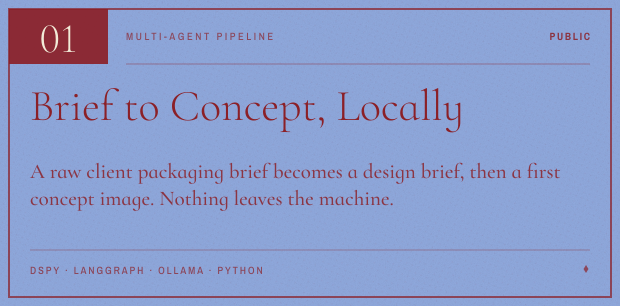
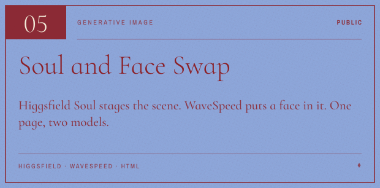

<table>
<tr>
<td width="38%" valign="top">

</td>
<td width="62%" valign="top">

I build AI systems at a creative packaging agency in Berlin, and I care what they
look like when they are finished. Most people in this field have no visual
vocabulary. Most people with a visual vocabulary cannot ship. The interesting
work is in between.

Turkish, English, German, and enough French to be dangerous.

The thing on the left is a real mesh, turning — twelve thousand triangles, lit and
rasterised here, then cut as line work the way a copperplate plate is cut.

</td>
</tr>
</table>

## Selected work

<table>
<tr>
<td width="50%"></td>
<td width="50%"></td>
</tr>
<tr>
<td width="50%"></td>
<td width="50%"></td>
</tr>
<tr>
<td width="50%"></td>
<td width="50%"></td>
</tr>
</table>

## About this page

Nothing here is a badge service. Every image is drawn by
[`tools/render.py`](tools/render.py) from the live GitHub API and redrawn nightly
by [a workflow](.github/workflows/refresh.yml).

GitHub renders README images inside ``, which blocks webfont loading — so the
type is not type. HarfBuzz shapes each line and fontTools converts the glyphs to
outlines, which is why Cormorant Infant and Archivo Narrow survive the trip
intact. The copy and the project list live in
[`data/profile.toml`](data/profile.toml); the layout measures itself against real
glyph widths rather than guessing.

A README cannot be interactive — there is no JavaScript, and pointer events never
reach an image. Motion is the part that survives, so every piece animates on load:
the rules draw, the name rises, the figures tick into place, and the six cards
below deal themselves out in sequence.

The octopus is the same constraint taken further. There is no WebGL either, so its
turn is a zoetrope: forty orthographic projections cycled by CSS. Each one is
rasterised properly — z-buffer, one lamp — and the tone that comes out is then cut
as hatching, parallel lines at a fixed angle whose *weight* carries the shading
rather than their spacing. Forty frames of flat-shaded polygons would have run to
megabytes and looked like a screensaver; this way the file scales with the number
of lines, not with the mesh. The hatching belongs to the plate and not to the
object, so it holds still while the animal turns.

Warm paper, near-black type, one oxblood mark. Paper grain on every surface.

## Elsewhere

[LinkedIn](https://www.linkedin.com/in/nihan-bayrak/) · Berlin, CET
